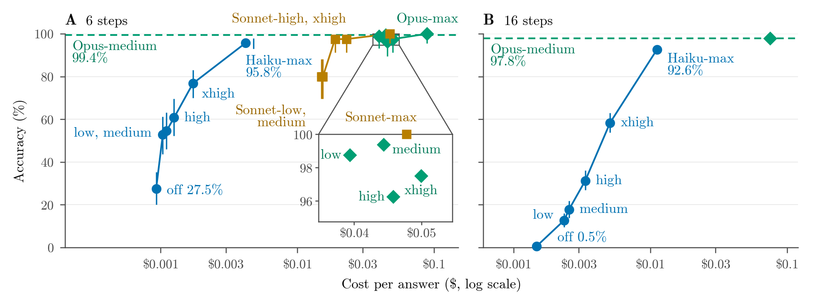

<div align="center">

<h1>More Answers, or Better Thinking?</h1>

<p><b>What a Fixed Budget Buys Across Claude 5.5 Models on Synthetic Multi-Step Puzzles</b></p>

<p>Hriday Kalpit Jain &nbsp;·&nbsp; Vivek Jain Lodha<br><sub>Independent</sub></p>

<p>
  <a href="LICENSE"></a>
  <a href="LICENSE-DATA"></a>
  <a href="#quick-start"></a>
</p>

<p>
  <a href="supplement.pdf"><b>Supplement</b></a> &nbsp;·&nbsp;
  <a href="#what-the-paper-finds"><b>Findings</b></a> &nbsp;·&nbsp;
  <a href="#quick-start"><b>Quick start</b></a> &nbsp;·&nbsp;
  <a href="#pre-registration-and-the-four-locks"><b>Pre-registration</b></a> &nbsp;·&nbsp;
  <a href="#citation"><b>Citation</b></a>
</p>

</div>

For a fixed-budget, exact-answer task, which is better: one larger-model answer, a majority vote of cheap-model answers, or more cheap-model thinking? We compare them at list prices across Claude 5.5 models on exactly marked synthetic puzzles, in two pre-registered studies, the second designed after the first. **For Haiku 5.5 on one synthetic family of exact multi-step puzzles, our reading across both studies, not a test, is effort first, then voting.**

This repository is the paper's released package: the pre-registrations, the run and analysis code, the result files and per-call tables, the records of the four pre-registration locks, and the paper's supplement as a PDF ([`supplement.pdf`](supplement.pdf)). After the install, every check in the [quick start](#quick-start) runs offline, with no API key and no cost.

> [!NOTE]
> This is the first release, v1.0.0. When this text was written, the paper was not yet on arXiv, and Zenodo had not yet given this release's archive its DOI, so neither is in this text. The next release adds the link to the paper and the archive's DOI.

<p align="center">
  
</p>

<p align="center"><sub><b>Figure 1 of the paper</b> (Figure S1 of the supplement): accuracy against list cost per answer. A: Study 1, 6 steps. B: Study 1b, 16 steps. Full caption below.</sub></p>

<details>
<summary>Full caption of Figure 1</summary>

> **Figure 1:** A cost-matched medium-effort Haiku vote was worse than one Opus-medium answer by more than the 10-point margin, while a small max-effort Haiku vote was shown no worse by more than 5 points at about its price. A: Study 1, 6 steps (chains filled, pieces hollow, each pair set slightly apart sideways); Tests 1–2, pre-registered decision rule, not Holm-adjusted. B: Study 1b, 16 steps, shapes pooled; Test B2, Holm-adjusted, its vote estimated from 10 samples, costing more than Opus-medium on chains and less on pieces. Values are d in points. Arrows in A to the Haiku-max sample are post hoc† (our reading, not a test); that sample is exploratory‡ in A and Test B1's challenger in B. Bars are 95% intervals, not drawn where shorter than the marker (A: Haiku-max on chains; B: every point but Haiku-medium). The panels come from different studies, so any comparison between them is descriptive.

The image is [`FIG-00.png`](data/paper-outputs/FIG-00.png), one of the fingerprinted outputs; [`FIG-00.pdf`](data/paper-outputs/FIG-00.pdf) is the vector copy and [`FIG-00.alt.txt`](data/paper-outputs/FIG-00.alt.txt) describes every point in words. In the caption, † marks post hoc and ‡ exploratory ([labels below](#what-the-paper-finds)).

</details>

## What the paper finds

**Our reading, not a test: effort first, then a small max-effort vote.** On one synthetic family of exact multi-step puzzles, raising Haiku 5.5's effort to max did far more than any way we tried to combine medium-effort Haiku answers (the paper's discussion, Section 5.1; each part keeps the label of its result). The results behind it, in the abstract's words:

- **Study 1, 6 steps.** On 6-step puzzles (changed from 24 steps before running), a vote of 36–40 medium-effort Haiku samples, costing no more than one medium-effort Opus answer, was worse than that answer by more than 10 points (d = −33.1 and −37.6; pre-registered rule, unadjusted; post hoc Holm agrees).
- **Study 1b, 16 steps.** On fresh 16-step puzzles, a vote of 6 max-effort Haiku samples, its accuracy estimated from 10, was shown no worse than one Opus-medium answer by more than 5 points (pre-registered test, Holm-adjusted). It cost about as much, more on chains and less on pieces: an alternative, not a saving.
- **One max-effort sample.** A single max-effort sample cost about 1/10–1/7 as much (6 and 16 steps) but scored 3.6–5.2 points lower (descriptive; pre-registered tests could not show it within 5 points).
- **Effort against votes.** Within each study, one max-effort sample beat cost-matched votes of lower-effort samples by 18–70 points (post hoc).
- **Scope.** One puzzle family, Claude 5.5, short prompts, October 2026 prices; Opus-medium stayed at 95.0–100.0%, so where it pulls ahead is untested.

<sub>Haiku-medium is Claude Haiku 5.5 at medium effort, and so on. Each puzzle comes in two shapes: chains (one long chain of steps) and pieces (the same steps as separate pieces). Holm-adjusted means corrected by Holm's method across a study's tests (Tests 1–5, or B1–B3). A vote keeps the most common answer among a setting's samples of one puzzle. A vote is cost-matched when its k samples cost no more than one comparator answer at list price; Study 1b's 6-sample vote cost 0.894 times Opus-medium's price over both shapes together (1.091 times on chains, 0.733 times on pieces), so it is cost-matched over both shapes, not on chains alone. d is challenger minus comparator, in accuracy points, paired over puzzles.</sub>

<details>
<summary><b>The eight confirmatory tests, and how to read the labels</b></summary>
<br>

Every result carries one of four labels. Confirmatory results are the named tests (Tests 1–5, B1–B3), each read by the pre-registered decision rule. Pre-specified descriptive results are planned numbers outside the tests, with no p-value or verdict unless the text says so. Exploratory marks a planned setting or design outside the tests. Post hoc marks a result, analysis or arithmetic chosen after results were seen. Figures, tables and captions may also use a label's mark: ‡ for exploratory, † for post hoc.

The decision rule gives each test one of three readings:

- **Shown no worse than the comparator by more than the margin (Holm-adjusted)**, when the test passes after Holm's correction.
- **Worse by more than the margin**, when the upper end of the unadjusted two-sided 95% interval lies below minus the margin. This reading is not Holm-adjusted.
- **Inconclusive** otherwise: we could not show that it is within the margin.

Study 1's Tests 1–5 used 80 puzzles and a 10-point margin, Holm-corrected across the five tests. Study 1b's Tests B1–B3 used 5 points (primary) and 10 points (secondary), Holm-corrected across B1–B3 only.

| Test: comparison | d, points [95% interval] | Reading |
|---|---|---|
| **1:** Haiku-medium vote (k = 40) vs Opus-medium, pieces, 6 steps | −33.1 [−43.8, −23.8] | worse by > 10 (pre-registered rule) |
| **2:** Haiku-medium vote (k = 36) vs Opus-medium, chains, 6 steps | −37.6 [−48.8, −27.0] | worse by > 10 (pre-registered rule) |
| **3:** Haiku-medium vote (k = 13) vs Sonnet-medium, chains, 6 steps | −24.7 [−36.1, −12.2] | worse by > 10 (pre-registered rule; marking rule as run) |
| **4:** Step voting vs Opus-medium, chains, 6 steps | −42.5 [−53.8, −30.0] | worse by > 10 (pre-registered rule) |
| **5:** Opus-low vs Sonnet-medium, chains, 6 steps | +17.5 [+8.8, +27.5] | shown no worse by > 10 (Holm-adjusted) |
| **B1:** Haiku-max sample vs Opus-medium, 16 steps | −5.2 [−7.8, −2.7] | inconclusive at 5; shown no worse by > 10 (Holm-adjusted) |
| **B2:** Haiku-max vote (k = 6) vs Opus-medium, 16 steps | +0.6 [−1.1, +2.4] | shown no worse by > 5 (Holm-adjusted) |
| **B3:** Haiku-max sample vs Opus-medium, 6 steps | −3.6 [−7.0, −1.5] | inconclusive at 5; shown no worse by > 10 (Holm-adjusted) |

- Tests 1–5 were pre-registered at 24 steps and ran at 6 (Deviation 1), so the medium-effort vote results (Tests 1–3) apply to 6-step puzzles only.
- Among Tests 1–5, Holm's correction, which covers only the "no worse" reading, passed only Test 5. Tests 1–4's "worse" readings come from the unadjusted interval; a post hoc Holm check keeps all four as stated.
- Test 3's reading depends on how answers are marked: under the original marking rule, which Deviation 2 kept as a sensitivity check, it would read inconclusive (d = +0.3 [−13.6, +14.9]), and so it would with copy slips forgiven (d = −22.2 [−33.4, −9.7]), a view the supplement's S16 note lists as pre-registered.
- Test 4's step voting cost about 1/11 of Opus-medium's cost per puzzle, so it is a cheap baseline rather than a cost-matched result.
- Both of Test 5's settings, Opus-low and Sonnet-medium, ran one level below their model's default effort (medium for Opus, high for Sonnet).
- The second fact that goes with Test 5: on Study 1b's separate 6-step set (one sample per puzzle; across studies, descriptive), Sonnet at its default, high, scored 97.5% at $0.0188 per answer and Opus-low 98.8% at $0.0395. In a post hoc paired comparison there (against Test 5, a reading across studies, not a test), Sonnet-high differed from Opus-low by −1.3 points [−6.3, +2.5]. In our reading, Test 5 says nothing about Opus-low against Sonnet at its default: it backs the accuracy half of "a bigger model with less thinking", not the cost half (the paper's Table 8).
- Study 1b was designed after Study 1's results were opened: its 5-point margin, its vote cap of 10 samples and its 16-step length were chosen knowing Study 1's Haiku-max numbers.

The paper's Table 2 adds error-rate ratios and spend shares.

</details>

<details>
<summary><b>Figure 3: Haiku's accuracy at each effort level</b></summary>
<br>

<p align="center">
  
</p>

<sub><b>Figure 3 of the paper</b> (Figure S4 of the supplement). Haiku's accuracy climbs steeply with effort, below Opus's cost; Opus stays near its ceiling at every effort. Study 1b's effort sweep (pre-specified descriptive, no tests).</sub>

Haiku's pooled accuracy at 16 steps rose from 0.5% with thinking off to 17.8% at medium and 92.6% at max, and at 6 steps from 27.5% to 95.8%; only max reached the 90s, at about 4.4 times medium's cost per answer at 16 steps and 3.8 times at 6. The rise holds on pooled points, not in every cell.

</details>

<details>
<summary><b>How the studies were run</b></summary>
<br>

- **Models.** Claude Haiku 5.5, Sonnet 5.5 and Opus 5.5, at the fixed IDs `claude-haiku-5-5`, `claude-sonnet-5-5` and `claude-opus-5-5`, at effort levels from low to max. Every sample was drawn at temperature 1, the only value the API accepts.
- **Prices.** List prices per million input and output tokens: Haiku $0.10 and $0.50, Sonnet $2 and $10, Opus $4 and $20. We report list prices; the Batch API, through which every headline accuracy was measured, billed exactly half.
- **Puzzles.** Small ledgers of budget lines on which the model applies a sequence of printed rules and writes down every balance, so a script marks each answer exactly. Each puzzle comes in two shapes, one long chain of steps or the same steps as separate pieces. Every puzzle was generated fresh.
- **Budget.** In all, the API calls cost $104.14 of the $200 budget, as billed.

| Run | When (UTC, 2026) | What it did |
|---|---|---|
| Pilot 1 | 10-11, 20:48–21:27 | Exploratory: 24-step puzzles, too hard for Haiku, which led to Deviation 1 |
| Length sweep | 10-12, 07:28–07:53 | 4, 6, 8, 12 and 16 steps, 20 puzzles each; a Haiku-medium-only rule picked 6 steps |
| Main run | 10-12, 13:01–13:54 | Study 1: 80 puzzles in both shapes at 6 steps, Tests 1–5, and exploratory settings, Haiku-max among them |
| Study 1b | 10-13, 08:35–11:19 | Fresh puzzles: B1 and B2 at 16 steps on 80 puzzles, B3 at 6 steps on 40, the effort sweep and a 12-step point |
| Top-up run | 10-13, 11:50–14:09 | Exploratory: a Haiku-medium team, a picker over 8 answers, and step voting on pieces |

The supplement's Table S6 lists every logged run with its cost.

</details>

## What is in this repository

> [!NOTE]
> This repository holds the paper's version of the package. It is a fresh copy with no development history, plus the bare records of the four locks. Zenodo archives each release.

| Path | What it holds |
|---|---|
| [`studies/1-real-price/spec.md`](studies/1-real-price/spec.md) | Study 1's pre-registration |
| [`research/`](research) | Study 1b's pre-registration, the locked rules and notes, the run plans, the simulation and prompt code, simulated data for the tests, and one build input at its pinned version (listed below the table) |
| [`harness/`](harness) | Run code (`pareto/`), puzzle generator (`taskgen/`), analysis, table and figure code (`analysis/`), unit tests (`tests/`), the lock checker (`lockhash.py`, with its `released` mode), the release tool, `check_tracked.py` (after you push a copy, it names any file in `RELEASE-FILES.json` that git does not track), the output checker `analysis/check_outputs.py` (checks `data/paper-outputs/` against `MANIFEST.json` without rebuilding), `taskgen/regenerate.py` with `frozen-sets.json` (rebuilds the 28 frozen test sets) and the pinned requirements |
| [`data/main/`](data/main) | Analysis results of Study 1, Study 1b and the top-up run, and the post hoc analyses |
| [`data/pilot/`](data/pilot), [`data/plans/`](data/plans) | Results of Pilot 1 and the length sweep; run plans |
| [`data/pilot-plan.md`](data/pilot-plan.md) | An earlier pilot plan, not used (see the notes below) |
| [`data/raw/`](data/raw) | One folder per logged run (ten, one of them rejected by the API and not billed), each with its manifest and spend ledger and, where the run wrote one, its plan, calibration limits, k or result file. Pilot 1, the length sweep, the main run, Study 1b and the top-up run also have a per-call table; Pilot 1 and the length sweep also have `haiku_extract.csv`, the Haiku-medium rows that run's preset choice read (in Pilot 1, three 24-step rule-set presets, none picked; in the length sweep, the length pick). No reply text |
| [`data/paper-outputs/`](data/paper-outputs) | The 41 generated tables and figures, each number's source, `MANIFEST.json`, `MANIFEST.md`, `reproduction/` and `illustration/` (listed below the table) |
| [`ops/lock/LOCK-MANIFEST.md`](ops/lock/LOCK-MANIFEST.md) | The lock texts, each frozen test set's SHA-256, and Lock 4's SHA-256 for every file in it except the manifest itself (the earlier locks' file lists, with Git blob IDs rather than SHA-256, are in the lock records) |
| [`lock-records/`](lock-records) | For each lock, its tag object, its commit object and the commit's file list (each file's path and Git blob ID), with no file contents |
| [`LOCKED-FILES.md`](LOCKED-FILES.md) | Each released file from the working repository, its SHA-256 and its state in each of the four locks (the run folders in `data/raw/` are under no lock) |
| [`ops/spend-log.md`](ops/spend-log.md) | The cost of every paid run |
| [`decisions/`](decisions) | One file the table and figure build reads, at the version it pins (see the notes below); nothing else from this folder, and nothing from `paper/` |
| [`supplement.pdf`](supplement.pdf) | The supplement: the full version of the paper's appendix, with every table and figure the paper prints in full; the run log, the pre-registration timeline, the data stamps' fields, the exact intervals that replace collapsed ones, each lock's commit ID and tar SHA-256, and Table S34's two parts: the SHA-256 and, where one is recorded, the code commit of nine analysis files, and for each paid run its commit and the SHA-256 of each raw file its cost record lists |
| [`CITATION.cff`](CITATION.cff), [`.zenodo.json`](.zenodo.json), [`LICENSE`](LICENSE), [`LICENSE-DATA`](LICENSE-DATA), [`.gitattributes`](.gitattributes), [`RELEASE-FILES.json`](RELEASE-FILES.json) | Citation metadata; the two licences; `.gitattributes`, one rule (`* -text`, with two comment lines) so that git never changes a line ending and every hash holds in a Windows clone; and a list of the files copied from the working repository and the files supplied for the release (this page and the supplement), each with its SHA-256, plus the names of the files the release tool generates and each lock's commit and tag IDs |

- **In `research/`:** Study 1b's pre-registration, `study1b-spec.md`; the top-up run's specification, `topup-run-spec.md`, frozen in Lock 4; the plan the pilot followed, `pilot-plan-ledger.md`, bound by the locks from Lock 1 on (it changed once, for Lock 2); Study 1b's earlier plan, `study1b-plan.md`, which its specification replaced; the other rules and notes in the locks, `d72-d73-lock-spec.md`, `reporting-definitions-main.md`, `scoring-step-lines.md`, `d42-ledger-variant.md` and `e2-and-picker-prompts.md` (each file's state in each lock is in [`LOCKED-FILES.md`](LOCKED-FILES.md)); the simulation and prompt code in `models/`; simulated data for the tests in `fixtures/`; and the paper's claims-ledger tool, `paper-notes/tools/ledger.py`, at the version the table and figure build pins (see the notes below).
- **In `data/paper-outputs/`:** the tables as CSV and LaTeX, the figures as PDF, PNG and alt text, and `MANIFEST.json` with every file's SHA-256. [`reproduction/`](data/paper-outputs/reproduction) shows the form of every kind of prompt the runs sent, on the paper's illustrative puzzle (a labelled placeholder stands in for any text a model wrote), with each setting's request and the price table. [`illustration/`](data/paper-outputs/illustration) holds that puzzle, made fresh for the paper's figure and not from any test set: its chain and pieces prompts, their reference replies and `illustration.json`, with a `SHA256SUMS` file. [`MANIFEST.md`](data/paper-outputs/MANIFEST.md) lists every output with its title and section.

The data and outputs are under CC BY 4.0 ([`LICENSE-DATA`](LICENSE-DATA)); the code is under MIT ([`LICENSE`](LICENSE)).

<details>
<summary><b>Notes on some files</b></summary>
<br>

- Apart from the seven locked files that have changed since Lock 4 (listed under [Check the release against the locks](#check-the-release-against-the-locks)) and the code added for the release (the release tool, `harness.taskgen.regenerate`, `check_outputs`, `check_tracked`, the build's `--from-disk` and as-built modes, and the tests' skip guards), files are released as they stood, not edited for publication: any fingerprint recorded for a file still holds, and we left the files that have none unedited too. Some therefore show local folder paths or our GitHub handle, cite internal decision numbers in their text or their file names, or name our own work sessions, and the folder notes inside `harness/` describe earlier stages of the code. The names Jarvis, Karen, Friday, Edith and Vision, used throughout the files, are those work sessions: separate AI (Claude) sessions, not people (see [Use of AI tools](#use-of-ai-tools)), so "Edith's clearance" or the guard's `edith_clearance` field means a check by one of those AI sessions. Where they differ, this page and the paper are current.
- `.gitignore` still lists `data/raw/`, a working rule kept for its locked bytes; the folder is included.
- `data/pilot-plan.md` is an earlier pilot plan for two other puzzle families (digits and code), proposed on 2026-10-10 and not used. The pilot that ran follows `research/pilot-plan-ledger.md`.
- The table and figure build reads two files at the versions it pins, and they are included at those versions: the output plan (`decisions/briefings/2026-10-15-compiler/plan-result.json`) and the paper's claims-ledger tool, whose list of retired words the build checks against (`research/paper-notes/tools/ledger.py`). A third file the table and figure build pins, `paper/tools/anon.py` (read only for the anonymous copies of `TAB-19` and `TAB-20`), is left out of the package because it holds personal identifiers; nothing here needs it to rebuild, and the two tables that read it, `TAB-19` and `TAB-20`, ship as built anyway.
- `ops/spend-log.md` adds up to $104.16: our records' raw total also prices two refusals in a setup check that the vendor does not bill ($0.0268). The paper's $104.14 is as billed: under the vendor's rule for billing refusals our records total $104.1353, which agreed with the Anthropic Console's $104.14 within one cent.

</details>

### What is not here, and why

- **The test puzzle files** (`data/tasks/`). They are not shipped as files, but they are not secret: the released generator (`harness/taskgen/`) rebuilds every frozen test set exactly, answers included, from its set name, which every item id in the per-call tables carries. A rebuilt set's `items.jsonl` can be checked against its SHA-256 in `ops/lock/LOCK-MANIFEST.md` (Lock 4) and its Git hash in the lock records (the rebuilt `manifest.json` records the rebuild, not the freeze, so it differs from the frozen one) ([how](#regenerate-a-test-set)).
- **The models' raw replies** (`calls.jsonl`, one per run). The package was planned to hold what each call cost and scored, not the text the model wrote. The models' original replies are not released, so our marking of them cannot be redone from this package; the per-call tables give each reply's outcome: each call's id, model, effort, token counts, cost, stop reason and mark.
- **Working records.** The development history, project notes and reviews, the decision record, the free runs and the paper's source are not part of the package, apart from the two build inputs named in the notes above. The paper and supplement report the run log, the pre-registration timeline and every change to a locked plan.

**What this means for checking.** From this package you can:

- check every shipped table and figure against its SHA-256;
- rebuild 35 of the 41 generated tables and figures (the paper's and the supplement's) byte for byte;
- recompute single-sample accuracies, token counts and costs from the per-call tables;
- rebuild every frozen test set exactly;
- check the released files against the locks.

You cannot re-run the analyses that read the replies: each run's analysis, which marks each reply, forms the votes and runs the tests, the length curve and length choice, and the post hoc analyses. Their outputs ship as computed in `data/main/` and `data/pilot/`. The supplement's Table S34 prints the SHA-256 of the `calls.jsonl` of every paid run except the setup check smoke-2 (whose row lists no files) and, for the main run, Study 1b and the top-up run, of its `runner.log` and `window.json`; those files are not released, so those hashes cannot be checked from this package. The hashes of the other files it lists, in either of its two parts, can be checked against the files held here: the per-call tables (`compact_table.csv`), the spend ledgers (`ledger.jsonl`), the run manifests (`manifest.json`), Study 1b's and the top-up run's plan files, Study 1b's `calibration_limits.json`, the result files (`*_result.json`) and the analysis files. A post hoc result file's `module_sha256` (in the 16 files of `data/main/free-analyses/` and in Pilot 1's recount in `data/pilot/`) is the SHA-256 of the analysis module as it stood when that file was written, recorded beside the git commit it ran at. The module was edited between runs, so only one of the 16 files (and the Pilot 1 recount) records the same hash as the module released in `harness/analysis/`; the others record an earlier version of it.

The diagrams in the paper's Figures 2 and 4 (Figures S7 and S8 of the supplement), the paper's Table 4 (Table S5) and the supplement's Figure S9 are written in the paper's source, not generated, so they are not among the 41 outputs; in this package they appear only in the supplement PDF.

## Quick start

The package was made with Python 3.9.6 and git 2.39.5 on macOS 14 (Apple silicon); other systems are untested. The pinned numpy 1.26.4 installs only on Python 3.9 to 3.12 (it has no wheels for 3.13 or newer), so use Python 3.9 if you can; we have not checked that 3.10 to 3.12 reproduce the figures byte for byte. The commands need no git history, so they also apply to the release archive on Zenodo.

```bash
git clone https://github.com/Hrixay/more-answers-or-better-thinking
cd more-answers-or-better-thinking
python3 -m venv .venv && source .venv/bin/activate
pip install -r harness/requirements-paper.txt
```

`harness/requirements-paper.txt` pins matplotlib 3.9.4, numpy 1.26.4 and six other libraries exactly. Rebuilt figures are compared byte for byte, so the build refuses any other versions. `harness/requirements.txt` pins `anthropic==0.125.0`, which only paid runs need.

### Check the shipped files

Compare every shipped table and figure file with its SHA-256 in `data/paper-outputs/MANIFEST.json`:

```bash
python3 -m harness.analysis.check_outputs
```

It reports `different: 0; missing: 0` and ends with the line `ok`. It also names the outputs whose pinned sources this copy holds (`rebuildable here`) and those that ship as built. Its counts include one output beyond the 41, `ledger-derived`, a file of derived values: it lists 42 outputs, 36 of them rebuildable here (the 35 that [rebuild](#rebuild-the-tables-and-figures), and `ledger-derived`) and six that ship as built.

The `reproduction/` and `illustration/` folders in `data/paper-outputs/` each carry a `SHA256SUMS` file. Check one from inside its folder (on macOS, `shasum -a 256 -c SHA256SUMS`):

```bash
(cd data/paper-outputs/reproduction && sha256sum -c SHA256SUMS)
```

### Rebuild the tables and figures

Rebuild into an empty folder, then compare byte for byte:

```bash
out=$(mktemp -d)
python3 -m harness.analysis.paper_outputs --from-disk --out "$out" &&
  diff -rq "$out" data/paper-outputs | grep -v -e '^Only in data/paper-outputs' -e 'MANIFEST\.'
```

The build prints `<id>: built` for each output it rebuilds and `<id>: as built` for each it cannot, records the reason in the new folder's `MANIFEST.json`, and ends with a `counts:` line: check that it shows `'as built': 6` (its `built` count also includes `ledger-derived`). If the build stops with an error, the comparison does not run. The new folder's `MANIFEST.json` and `MANIFEST.md` are left out of the comparison, because they give the six outputs the status `as built`, with their reasons, where the shipped manifest lists them as `built`. The comparison prints nothing when every rebuilt file is identical to the shipped one. The build itself prints 46 warnings from the font library about file timestamps and, on its first run, a line about building the font cache; they do not affect the result.

> [!NOTE]
> 35 of the 41 generated tables and figures rebuild here. The other six, `TAB-07`, `TAB-17`, `TAB-19`, `TAB-20`, `TAB-22` and `TAB-23`, ship as built: they read working records that are not released, and some also read git history. The check above still verifies their files by SHA-256. In our own run on a fresh copy of the package, the 268 files it rebuilt (the other 35 outputs' 267 files and `ledger-derived.json`) were byte for byte the shipped ones.

<details>
<summary><b>From the paper's numbering to the output files</b></summary>
<br>

`FIG-nn` and `TAB-nn` are build ids, not the paper's numbers. For the twelve tables in the mapping below that have `TAB-nn.main.*` files, those are the version the paper prints, and the plain files are the fuller table in the supplement. `TAB-08`, `TAB-16`, `TAB-21` and `TAB-25` are in the supplement only, printed as their plain files; their `.main` files are printed in neither PDF. Every other table is printed as its plain files. The shipped files carry placeholders that the paper's build fills in: `⟦TAB-nn⟧` and `⟦FIG-nn⟧` stand for a whole reference to a table or figure, and `⟦CAPTION⟧` and `⟦LABEL⟧` for a long table's own caption and label. They sit in 36 `.tex`, 2 `.csv` and 5 `.cells.json` files; the paper's source is not released, so they stay as they are. [`MANIFEST.md`](data/paper-outputs/MANIFEST.md) lists every output, the supplement's included, with its title and section.

| Figure | Output file |
|---|---|
| Figure 1 | `FIG-00` |
| Figure 2 | none (Figure S7) |
| Figure 3 | `FIG-04` |
| Figure 4 | none (Figure S8) |
| Figure 5 | `FIG-01` |
| Figure 6 | `FIG-03` |
| Figure 7 | `FIG-05` |
| Figure 8 | `FIG-06` |

| Table | Output file |
|---|---|
| Table 1 | `TAB-35` |
| Table 2 | `TAB-01` |
| Table 3 | `TAB-24` |
| Table 4 | none (Table S5) |
| Table 5 | `TAB-19` (ships as built) |
| Table 6 | `TAB-27` |
| Table 7 | `TAB-02` |
| Table 8 | `TAB-29` |
| Table 9 | `TAB-10` |
| Table 10 | `TAB-11` |
| Table 11 | `TAB-12` |
| Table 12 | `TAB-14` |
| Table 13 | `TAB-34` |

"None" marks the diagrams and the table written in the paper's source ([above](#what-is-not-here-and-why)). `FIG-02` (Figure S10), `FIG-07` (Figure S12) and `FIG-05`'s appendix version, the `FIG-05.appendix.*` files (Figure S11), appear in the supplement only.

</details>

### Run the tests

The unit tests use the standard library's `unittest`, with the libraries of `harness/requirements-paper.txt` installed as above. Run them from the top folder:

```bash
python3 -m unittest discover -s harness/tests -t .
```

Tests that need files or git history the release leaves out are skipped, so a git clone, which has history, and the Zenodo archive, which has none, can skip different numbers of tests. In a fresh copy of this release with no git history, as in the Zenodo archive, unittest reports `Ran 1130 tests` and `OK (skipped=37)`: 1,093 passed and 37 were skipped (unittest counts the skipped tests in the total). One of the skipped tests compiles a LaTeX table with `tectonic` and runs only when you set `PARETO_TECTONIC=1`, so the count does not depend on whether `tectonic` is installed.

## Pre-registration and the four locks

Study 1's pre-registration is [`studies/1-real-price/spec.md`](studies/1-real-price/spec.md); Study 1b's is [`research/study1b-spec.md`](research/study1b-spec.md). Each lock is a git tag in a repository that stayed private. Its public fingerprint is the commit ID and the SHA-256 of the uncompressed tar from `git -c tar.umask=0002 archive --format=tar <tag>`, made with git 2.39.5, because another git version can write a different tar. The fingerprints went on Zenodo, a public gist and the Internet Archive's Wayback Machine; Lock 2 was posted on Zenodo only, and Lock 3's Zenodo record came after the main run began, after its gist and Wayback snapshot. The supplement's Table S10 gives the dated timeline. The paper's Table 4 (Table S5 of the supplement) gives each lock's commit and tar SHA-256, and its Table 5 (Table S9) lists every change to a locked plan.

| Lock | Tag cut (UTC) | What it fixed | Public records |
|---|---|---|---|
| 1 | 2026-10-11 19:32 | Study 1's plan for 24-step puzzles, with the puzzle generator and its frozen puzzle sets, before Pilot 1 | [Zenodo](https://doi.org/10.5281/zenodo.23304164) · [gist](https://gist.github.com/Hrixay/f8da61f9185b5f28bd5780ea55e810a5) · [Wayback](https://web.archive.org/web/20261011193547/https://gist.github.com/Hrixay/f8da61f9185b5f28bd5780ea55e810a5) |
| 2 | 2026-10-12 07:11 | Deviation 1 (the length to be chosen by a Haiku-medium-only rule), new frozen puzzle sets at each length, Study 1b's test puzzles among them, and the length sweep | [Zenodo](https://doi.org/10.5281/zenodo.23311831) |
| 3 | 2026-10-12 09:11 | Amendment 1 (filled in only the values the locked rules chose after the length sweep, plus four disclosures; no test added and no rule changed) and Deviation 2 (a repeated step line with identical balances is accepted, for every model), before the main run began | [gist](https://gist.github.com/Hrixay/eb3ec6a6a9900df0560a4e5a81e07b93) · [Wayback](https://web.archive.org/web/20261012102601/https://gist.github.com/Hrixay/eb3ec6a6a9900df0560a4e5a81e07b93) · [Zenodo](https://doi.org/10.5281/zenodo.23313537) |
| 4 | 2026-10-13 07:33 | Study 1b and the top-up run | [Zenodo](https://doi.org/10.5281/zenodo.23335207) · [gist](https://gist.github.com/Hrixay/f0ec2ea88da93788511b21c9ab036d94) · [Wayback](https://web.archive.org/web/20261013073439/https://gist.github.com/Hrixay/f0ec2ea88da93788511b21c9ab036d94) |

The four Zenodo records are versions of one record (all versions: [10.5281/zenodo.23304163](https://doi.org/10.5281/zenodo.23304163)), separate from this repository's own archive. Study 1's reporting definitions were written after Lock 3 and fixed by the main run's public data stamp (below) before any result was opened; the supplement's Section S3.8 gives the timing.

<details>
<summary><b>The three data stamps</b></summary>
<br>

Three public data stamps, each posted before any result of its run was opened, fixed the raw-file fingerprints. The main run's stamp also fixed Study 1's analysis driver and reporting definitions.

| Run | Public records |
|---|---|
| Main run | [gist](https://gist.github.com/Hrixay/a604ef9b54ef660da299873c66406b61) · [Wayback](https://web.archive.org/web/20261012141856/https://gist.github.com/Hrixay/a604ef9b54ef660da299873c66406b61) |
| Study 1b | [gist](https://gist.github.com/Hrixay/52dd104cb9851d2cc221e8ce501c5a86) · [Wayback](https://web.archive.org/web/20261013112716/https://gist.github.com/Hrixay/52dd104cb9851d2cc221e8ce501c5a86) |
| Top-up run | [gist](https://gist.github.com/Hrixay/c9870cf28c1f5a4c5b74129e4bb75485) · [Wayback](https://web.archive.org/web/20261013141633/https://gist.github.com/Hrixay/c9870cf28c1f5a4c5b74129e4bb75485) |

</details>

### Check the release against the locks

**Every released file against Lock 4.** The lock manifest holds Lock 4's file list with each file's SHA-256 (the earlier locks' lists, with Git hashes, are in [`lock-records/`](lock-records)). This reads that list:

```bash
python3 -m harness.lockhash released
```

It first checks that the list's file count and digest match its lines, then reports how many listed files this copy holds with the locked bytes, how many it holds changed (naming each), and how many it does not hold. We expect seven changed files: this README, the lock checker and its test (which gained the `released` mode), three other tests (`test_neversent.py`, `test_prices.py` and `test_topup_analysis.py`, which now skip checks that need files or git history the release leaves out), and the spend log (which gained the rows and totals of the runs made under Lock 4). Locked files not in this copy are the ones the release leaves out. On the release package the list has 1,363 files: 221 held with the locked bytes, 7 held changed and 1,135 not held. The `check` and `write` modes named inside the lock manifest are for the original repository; here use `released`.

**One file by hand.** Both lines show the same SHA-256 (on Linux, use `sha256sum`):

```bash
shasum -a 256 studies/1-real-price/spec.md
grep -E "^[0-9a-f]{64}  studies/1-real-price/spec.md$" ops/lock/LOCK-MANIFEST.md
```

**Each lock's commit.** Hashing the bare commit records gives the commit IDs printed in the paper's Table 4 (Table S5):

```bash
(cd lock-records && for n in 1 2 3 4; do git hash-object -t commit prereg-lock-$n.commit; done)
```

```text
b4b6b8474f39538055b3e358b48243d51aca5e3b
95fb5f81b9a3a131da77f5a776af200c8e60477d
086fbfd04063a10e2c64f2a737e5771b0aa70dc8
d1c565fc9188d56e970bbb15ce908271627ccf0a
```

[`LOCKED-FILES.md`](LOCKED-FILES.md) gives each released repository file's state in all four locks: `=` for the same bytes, `changed` for other bytes, or `-` for not in that lock's list of file hashes. The lock manifest (`ops/lock/LOCK-MANIFEST.md`) never lists itself, so its row shows `-` in every lock even though every lock holds it; its Git blob IDs are in `lock-records/<tag>.files`, and this copy matches Lock 4's. A file can differ between locks because a later lock fixed new plans and code, so `changed` alone does not mean a locked plan was amended; the paper's Table 5 (Table S9) lists every change to a locked plan.

<details>
<summary><b>Tie a file list to its commit, and check a file against Locks 1–3</b></summary>
<br>

Each record in `lock-records/` holds a lock's tag object (`.tag`), its commit object (`.commit`) and the commit's tree as `git ls-tree -r` prints it (`.files`): each file's mode, Git blob ID (SHA-1) and path, with no contents. Rebuild the tree from the list in a new, empty folder and compare it with the `tree` line of the commit record. Both lines show the same ID (for Lock 4, `932d327cbdf6373a09be7ee3bf763393c96b3082`):

```bash
git init -q /tmp/lock4-tree
git -C /tmp/lock4-tree update-index --index-info < lock-records/prereg-lock-4.files
git -C /tmp/lock4-tree write-tree --missing-ok
head -1 lock-records/prereg-lock-4.commit
```

The file lists carry Git blob IDs (SHA-1), not SHA-256. To check a released file against Lock 1, 2 or 3, compare its blob ID with its line in that lock's list; for Lock 3, both show `f717299cc77adb5113b7935a68e277b687e9cec7`:

```bash
git hash-object studies/1-real-price/spec.md
awk -F'\t' '$2 == "studies/1-real-price/spec.md"' lock-records/prereg-lock-3.files
```

The lists also name files that are not released, with their IDs but not their contents. For the same reason, a lock's tar SHA-256 cannot be recomputed from this package.

</details>

### Regenerate a test set

The released code rebuilds a frozen test set, answers included, from its set name, and checks the rebuilt `items.jsonl` against the SHA-256 in the lock manifest. The tool holds each set's build parameters, not its puzzles. `--out` is a folder in which the set's own subfolder does not exist yet (running the same set again needs a new folder):

```bash
python3 -m harness.taskgen.regenerate --list
python3 -m harness.taskgen.regenerate --set main-ledger-l14n6-v1 --out /tmp/sets --check
```

The first command lists the 28 frozen sets. The second writes Study 1's test set (80 puzzles, each in both shapes) to `/tmp/sets/main-ledger-l14n6-v1` and prints one line that ends in `yes` when the rebuilt file is byte for byte the locked one, or `no` when it is not. `--set all` runs every set in turn. Study 1's set takes seconds; the sets built with the older `l16` and `l17` presets take hours. In our own run, all 28 sets rebuilt byte for byte.

A rebuilt set can also be checked against the lock records' Git hash, from any lock that holds it:

```bash
git hash-object /tmp/sets/main-ledger-l14n6-v1/items.jsonl
awk -F'\t' '$2 == "data/tasks/main-ledger-l14n6-v1/items.jsonl"' lock-records/prereg-lock-4.files
```

The `reproduction/` folder was built by `python3 -m harness.analysis.reproduction --tasks <folder> --out <folder>`. It proves the illustrative puzzle shares nothing with any frozen set, so `--tasks` must hold all 28 frozen sets, with the counts recorded for them; with fewer it stops. Rebuild them into a new folder outside `data/tasks/`, which the generator refuses to write under (`python3 -m harness.taskgen.regenerate --set all --out /tmp/all-sets --check`, then `--tasks /tmp/all-sets`; do not reuse `/tmp/sets` from the example above, where Study 1's set already is). Run on the 28 rebuilt sets, it writes the same 25 files: 23 match the shipped ones byte for byte, and only `prompts.json` and `SHA256SUMS` differ: `prompts.json` holds one different count (`team_prompt_renders_compared` reads 0, not 8), because the eight team-prompt renders it compares are renders of test items and are not released, and `SHA256SUMS` differs only in `prompts.json`'s line. The shipped files are checked by their `SHA256SUMS` ([above](#check-the-shipped-files)).

## Re-running the paid experiments

> [!WARNING]
> Live runs send paid API calls. Replies are sampled at temperature 1, so a new run gives new samples, not ours, and models, prices and the API change over time.

- **`plan` and `dry` runs are free.** The spend guard is a dry run by default, and only the `live` mode sends calls. `plan` and `dry` never touch the network and never read `.env`. With the set regenerated above, this prints Study 1's call plan as JSON:

  ```bash
  python3 -m harness.pareto.main plan --set /tmp/sets/main-ledger-l14n6-v1 --extras sl,ho,hx
  ```

- **What `live` needs.** The `live` mode runs behind the spend guard we used, which reserves each call's worst-case cost and refuses to pass its caps. It needs `--cap` and `--clearance FILE`. The clearance file is JSON whose fields the guard checks: the run id and cap, the data folder and `.env` path, a clean git commit, a price-table date of today or yesterday (the released table is dated 2026-10-12), an expiry within 7 days, a go-ahead note starting `go:`, and a review file under `ops/reviews/` holding the exact line `CLEARED: <run_id> <git_commit> <ledger_root>`. No such file ships: the gate was built for this project's own reviews, so a reader writes their own clearance file. The guard's $200 global cap also counts the spend already in `ops/spend-log.md`. A paid re-run therefore means adapting the guard and the price table first. ["The live gate" in `harness/pareto/README.md`](harness/pareto/README.md#the-live-gate) gives every check.
- **The API key** goes in a `.env` file at the top level, as `ANTHROPIC_API_KEY=...`; git ignores `.env`. Install `harness/requirements.txt` only for live calls. The spend guard uses `fcntl`, which every run mode imports, so `plan`, `dry` and `live` runs need macOS or Linux.

## Scope and limits

- The scope is narrow: one synthetic puzzle family at 6 to 16 steps, the Claude 5.5 models only, short prompts and the list prices of 2026-10-12/13.
- Opus-medium scored 95.0–100.0% on each shape at every length up to 16 steps. We never reached puzzles hard enough to make Opus fail. At 12 and 16 steps, Study 1b ran only Opus-medium besides Haiku, so every 16-step comparison there is with one alternative.
- Near that ceiling a margin is generous: B1 and B3 were shown no worse than Opus-medium by more than 10 points, the secondary margin (Holm-adjusted), although a single Haiku-max sample made 3.4 and 6.8 times its errors, and B2's 5-point margin, chosen after Study 1's exploratory result, would allow about 3.3 times Opus-medium's error rate.
- The rule kinds were developed in free runs with Haiku inside Anthropic's Claude Code app, adding kinds where it slipped. In Study 1, Haiku slipped 4.0 times as often per step on these tuned kinds as on general steps (90% interval 3.2 to 5.1), so effort's gain may lean on them. Its slips there also repeated less often, in 66.6% of same-step pairs against 89.2% (the pre-specified tuning check), which favours voting on them (our reading, not a test). The exploratory fairness check's flag did not fire (targeting index 0.82, 90% interval 0.43 to 1.37). Two pre-registered checks bound this bias rather than remove it.
- Prompts were short, about 970 to 1,920 input tokens. Haiku's higher price for long prompts would cut Opus's price ratio from 40 times to 8 times, so long-context and agent work need their own measurement.
- A same-meaning rewording could move Haiku-medium's score by up to about +17.3 points.
- Whether cheap models can be trusted as judges, a second question we set out with, stays open. Our only direct data is one exploratory picker, which was not shown to beat a plain vote over the same 8 answers (across the two runs; the drift check did not fire). Nothing here tests grading a single answer, a stronger judge or judging max-effort answers, and the paper does not generalise to language models as judges.
- Every multi-call design ran only at medium effort; at max effort only plain votes ran. Apart from those votes, no multi-call design was cost-matched, so the results say nothing about decomposition at Opus-medium's budget, on top of max effort, or on a task whose steps are not given.
- Price parity is an approximation: it prices each answer's calls at list price, leaving out latency, rate limits, orchestration and any judge needed where answers cannot be matched exactly.
- Two 6-step sets from the same generator gave the weak Haiku settings scores 4.8–9.9 points apart, while Haiku-max and Opus-medium barely moved, so every comparison across the two studies or across puzzle sets is descriptive, and any conclusion from it is our reading, not a test. The numbers of puzzles are small: Study 1's tests have 95% intervals 18.8 to 23.9 points wide, and the Sonnet and non-medium Opus effort points rest on one sample per puzzle.
- The figure files are byte-identical only with the pinned plotting libraries, and we have not checked this on Linux.

## Use of AI tools

The authors conceived and designed the study and made every research decision: the question, the experimental design, each pre-registration and deviation, every paid run, and the interpretation and framing of the results. They edited and approved the final text. AI tools (Anthropic's Claude) were used under the authors' direction as research assistants, to implement and run the code, check results against the data, and draft text for the authors' review. Anthropic had no role in the study, and the authors take full responsibility for its content.

The study's checks and re-runs were done by separate AI work sessions, not by independent people, and their separation rests on written records and file hashes, not an access log. The API calls were paid for with a $200 API credit that came with the first author's Claude Max subscription.

## Licence

| Part | Licence | File |
|---|---|---|
| All code: `harness/`, `research/models/`, the scripts in `research/fixtures/`, and `research/paper-notes/tools/ledger.py` | MIT ("Copyright (c) 2026 Hriday Kalpit Jain") | [`LICENSE`](LICENSE) |
| Everything else in the repository other than the code: the result files, per-call tables, run records, lock records, plans and pre-registrations, the paper's tables and figures, and the supplement | CC BY 4.0 | [`LICENSE-DATA`](LICENSE-DATA) |
| The paper and its supplement | CC BY 4.0 (the text is in [`LICENSE-DATA`](LICENSE-DATA)) | The supplement: [`supplement.pdf`](supplement.pdf). The paper: to be posted on arXiv under CC BY 4.0; the next release adds the link |

## Citation

If you use this work, please cite the paper:

```bibtex
@misc{jain2026moreanswers,
  title  = {{More Answers, or Better Thinking? What a Fixed Budget Buys Across Claude 5.5 Models on Synthetic Multi-Step Puzzles}},
  author = {Jain, Hriday Kalpit and Lodha, Vivek Jain},
  year   = {2026},
  note   = {Code and data: https://github.com/Hrixay/more-answers-or-better-thinking}
}
```

The next release adds the paper's arXiv identifier to this entry and the DOI of this repository's Zenodo archive. GitHub's **Cite this repository** button, in the sidebar, is built from [`CITATION.cff`](CITATION.cff) and gives this repository's citation in APA and BibTeX form.

## Contact

Hriday Kalpit Jain, corresponding author: [hridayjain403@gmail.com](mailto:hridayjain403@gmail.com)
